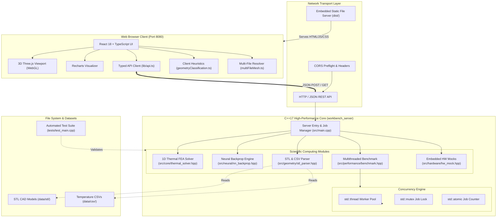

# Software Architecture and Project Structure
**Unified Engineering Workbench**  
**System Architecture Specification & Technical Reference**

---

## 1. System Overview

The **Unified Engineering Workbench** is an interdisciplinary engineering workstation designed for thermal finite-element analysis (FEA), 3D CAD and point cloud visualization, parallel performance benchmarking, neural network backpropagation verification, and embedded hardware simulation.

The platform employs a decoupled **Client-Server Micro-Workstation** architecture:
- **Core Computational Backend**: Built with high-performance **C++17**, providing deterministic, zero-overhead numerical solvers, ASCII STL parsing, multithreaded benchmarking, and hardware state machines.
- **Scientific Presentation Frontend**: A modern Single Page Application (SPA) built with **React 18**, **TypeScript 5**, **Vite 6**, and **Three.js / React Three Fiber**, offering interactive 3D WebGL rendering, parametric charting, and real-time telemetry dashboards.
- **Embedded Static Server**: The C++ server embeds static file resolution, enabling a single executable to host both the REST API and the pre-built React application on Windows, macOS, and Linux without requiring external web servers (Nginx/Apache).

---

## 2. System Architecture Diagram



---

## 3. Communication Protocol and Data Flow

Communication between the React presentation layer and the C++ engine occurs over standard HTTP/1.1 with JSON payloads.

### 3.1 Synchronous Request-Response Flow
For low-latency computations ($< 50\text{ ms}$), the client makes direct synchronous `POST` or `GET` calls:
1. **Thermal FEM Solution (`POST /api/thermal/solve`)**:
   - Request: `{ "n_elements": 20, "L": 1.0, "A": 1e-4, "k": 10.0, "q": 10000.0, "T0": 100.0, "TL": 20.0 }`
   - Processing: Server parses JSON, invokes `thermal::solve()`, constructs nodal result arrays, returns JSON response.
   - Latency: Typical execution time is $< 2\text{ ms}$.
2. **Neural Training & Gradient Check (`POST /api/neural/train`)**:
   - Request: `{ "n_steps": 100, "lr": 0.1 }`
   - Processing: Evaluates analytical chain-rule gradients, computes central finite differences, runs 100 SGD iterations, returns parameter trajectory.
3. **Geometry Parsing (`POST /api/geometry/parse-stl` & `POST /api/geometry/parse-csv`)**:
   - Uploads file contents as a JSON string payload, receives parsed vertices, surface normals, bounding box coordinates, and temperature ranges.

### 3.2 Asynchronous Job Lifecycle (Long-Running Tasks)
For computationally heavy operations such as multi-core scaling benchmarks:
1. **Job Dispatch**: Client submits `POST /api/performance/benchmark` with `{ "n_cases": 50, "n_elem": 40 }`.
2. **Immediate Acknowledgment**: Server registers a new entry in `g_jobs`, assigns a unique `job_id`, spawns a detached `std::thread`, and immediately returns HTTP 200 with `{ "success": true, "job_id": 42 }`.
3. **Client Polling Loop**: The client (`frontend/src/pages/PerformanceLab.tsx`) polls `GET /api/jobs/42` every 400 milliseconds.
4. **Job Completion**: When the worker thread finishes, it updates job status to `done` with complete benchmark metrics (serial time, parallel times, speedup, efficiency, numerical agreement error).
5. **UI Rendering**: The client detects `status: "done"`, terminates polling, and renders speedup charts.

### 3.3 Hardware Simulation Polling
The embedded hardware simulation page (`HardwareIntegration.tsx`) executes an active heartbeat:
- Queries `GET /api/hardware/devices` to fetch device catalog and connection status.
- Issues `POST /api/hardware/connect` with `{ "device": "mcu", "simulate_failure": false }`.
- Polls `GET /api/hardware/telemetry/mcu` at $1\text{ Hz}$ to render dynamic voltage, current, and temperature telemetry curves with simulated Gaussian jitter.

---

## 4. Directory Structure and Architectural Responsibilities

### 4.1 `/src` (C++ Backend Source)
- **`src/main.cpp`**: Server entry point. Initializes `httplib::Server`, configures CORS headers, defines route handlers, manages background job states, discovers static `dist/` directories, and binds to TCP port 8080.
- **`src/core/thermal_solver.hpp`**: 1D finite-element solver. Formulates element stiffness matrices $k_e$, load vectors $f_e$, applies Dirichlet boundary conditions via row/column zeroing, solves $KT=F$ via Gaussian elimination with partial pivoting, and evaluates analytical closed-form solutions for midpoint error verification.
- **`src/geometry/stl_parser.hpp`**: Lexical ASCII STL parser and temperature CSV parser. Computes axis-aligned bounding boxes (AABB), geometric centers, surface normals, and spatial temperature distributions.
- **`src/performance/benchmark.hpp`**: Multithreaded performance benchmarking suite. Generates reproducible test cases using `std::mt19937_64(42)`, executes serial and parallel ($1 \le W \le 4$) solutions across CPU cores, and verifies numerical agreement between serial and parallel runs.
- **`src/neural/nn_backprop.hpp`**: Handcoded backpropagation engine. Implements single-neuron regression ($h=\tanh(wx+b), \hat{y}=vh+c, J=\frac{1}{2}(\hat{y}-y)^2$), analytical gradients via chain rule, central finite-difference gradient checks ($\epsilon=10^{-6}$), and gradient descent updates.
- **`src/hardware/hw_mock.hpp`**: Simulated embedded hardware drivers for STM32F4 MCU, Xilinx Artix-7 FPGA, and Segger J-Link JTAG adapter. Features simulated connect/disconnect sequences, register telemetry, and configurable fault injection.

### 4.2 `/frontend` (React + TypeScript Scientific Client)
- **`frontend/src/App.tsx`**: Workstation navigation, tab switching, global notification banner, and theme switching context.
- **`frontend/src/pages/GeometryViewer.tsx`**: 3D scientific viewport utilizing Three.js and React Three Fiber. Supports wireframe, solid, faceted, and temperature colormap modes, camera auto-fit, and multi-file mesh assembly.
- **`frontend/src/pages/ThermalAnalysis.tsx`**: FEA testbench with parameter controls, temperature profile plots, nodal data tables, and $O(h^2)$ convergence analysis.
- **`frontend/src/pages/PerformanceLab.tsx`**: Benchmark visualizer plotting execution time vs. thread count, Amdahl speedup, and multi-core efficiency.
- **`frontend/src/pages/HardwareIntegration.tsx`**: Embedded systems workbench with MCU/FPGA/JTAG status indicators, pinout matrices, star-ground wiring diagrams, and telemetry streams.
- **`frontend/src/pages/NeuralNetworkLab.tsx`**: Neural network laboratory providing forward pass step-through, gradient verification tables, and dynamic loss convergence graphs.
- **`frontend/src/pages/TestResults.tsx`**: In-app test console running 128 C++ unit tests and browser-side validation suites.
- **`frontend/src/lib/api.ts`**: Centralized HTTP client wrapping `fetch` with error normalization, parameter validation, and connection timeouts.
- **`frontend/src/lib/geometryClassification.ts`**: Heuristic mesh classifier detecting whether uploaded data represents 1D rods, 2D plates, 3D grids, or unstructured point clouds.
- **`frontend/src/lib/multiFileMesh.ts`**: Multi-file mesh assembler resolving separate node CSV and triangle face CSV files into unified 3D geometries.

### 4.3 `/tests` and `/scripts`
- **`tests/test_main.cpp`**: Standalone C++ verification executable exercising 128 automated assertions across all mathematical and parsing modules.
- **`scripts/test_all.sh`**: Master automated verification pipeline that compiles and runs C++ unit tests, CTest, Node.js geometric tests, TypeScript type checks, production builds, and end-to-end Python HTTP integration tests.
- **`scripts/build_macos.sh` & `scripts/run_macos.sh`**: One-click build and execution scripts for macOS environments.
- **`scripts/launch_windows.bat` & `scripts/Launch.cpp`**: Standalone native Windows launcher executable that boots the backend server silently without an intrusive console window and opens the default web browser.

---

## 5. Build and Runtime Dependencies

The project intentionally avoids heavy external framework dependencies to ensure effortless portability across operating systems:

### 5.1 C++ Backend Dependencies
- **C++17 Standard Library**: Requires ISO C++17 compliant compiler (Clang 12+, GCC 9+, or MSVC 2019+).
- **cpp-httplib** (`httplib.h`): Single-header, cross-platform HTTP/HTTPS library (fetched automatically via CMake or bundled).
- **nlohmann/json** (`nlohmann/json.hpp`): Single-header JSON parsing and serialization library (managed via CMake `FetchContent`).
- **Platform Socket Libraries**:
  - Windows: `ws2_32.lib`, `crypt32.lib`
  - POSIX (macOS/Linux): `pthread`

### 5.2 Frontend Dependencies
- **Node.js**: Version 18.0 or higher (Node 20+ recommended).
- **React & ReactDOM** (`^18.3.1`): Core UI library.
- **Three.js** (`^0.170.0`) & **@react-three/fiber** (`^8.17.10`): WebGL 3D rendering pipeline.
- **@react-three/drei** (`^9.117.3`): Camera controls and 3D canvas helpers.
- **Recharts** (`^2.13.3`): Declarative charting library for convergence and telemetry graphs.
- **Lucide React** (`^0.460.0`): Clean, modern engineering iconography.

---

## 6. Startup, Static Asset Serving, and Shutdown Behavior

### 6.1 Server Startup and Auto-Discovery
When `workbench_server` executes:
1. Reads optional command-line argument for port binding (default: `8080`).
2. Configures CORS preflight wildcard handlers.
3. Maps REST API endpoints under `/api/*`.
4. **Locates Static Frontend Bundle**:
   - Searches candidate directories relative to both the executable path and working directory:
     - `exe_dir/dist`
     - `exe_dir/frontend/dist`
     - `exe_dir/../frontend/dist`
     - `cwd/dist`
     - `cwd/frontend/dist`
   - If a valid `index.html` is discovered, mounts the directory at `/` and registers SPA fallback routing.
   - If no pre-built bundle is found, outputs a console notice and operates in API-only mode.
5. Binds socket to `0.0.0.0:8080` and begins listening for incoming connections.

### 6.2 Process Shutdown and Resource Cleanliness
- On POSIX (`SIGINT`, `SIGTERM`) or Windows (`Ctrl+C`):
  - Sockets are closed gracefully.
  - The OS cleans up open socket descriptors and process memory.
  - Running background benchmark threads are detached and terminate when the parent process exits.

---

## 7. Error Handling and System Recovery

The workbench implements layered fault tolerance to guarantee high availability:

| Fault Scenario | Architectural Layer | Detection & Containment Mechanism | System Recovery Outcome |
| :--- | :--- | :--- | :--- |
| **Malformed STL File Upload** | `src/geometry/stl_parser.hpp` | Throws `std::runtime_error` during lexical scan (missing keywords, non-finite floats). | Server catches exception in `handle_parse_stl()`, returns HTTP 400 with `{ "success": false, "error": { "message": "..." } }`. UI displays alert banner and preserves existing 3D mesh. |
| **Invalid FEM Boundary Condition** | `src/core/thermal_solver.hpp` | Validates $k > 0, A > 0, L > 0, n_{\text{elem}} \ge 1$; throws `std::invalid_argument`. | Catches error in `handle_thermal_solve()`, returns HTTP 400. UI highlights invalid form inputs in red. |
| **Singular Linear System ($K$)** | `src/core/thermal_solver.hpp` | Pivot check during Gaussian elimination: `if (std::abs(diag) < 1e-15) throw std::runtime_error("Singular matrix");`. | Prevents division by zero or NaN propagation; returns structured error to client. |
| **Benchmark Thread Crash** | `src/main.cpp:340` | `try { ... } catch (const std::exception& e)` wraps the detached thread execution. | Updates job state in `g_jobs` to `{ "status": "error", "error": e.what() }`. Client polling displays error message without crashing server. |
| **Simulated Hardware Disconnection** | `src/hardware/hw_mock.hpp` | Calling `get_telemetry()` on disconnected device throws `std::runtime_error`. | API returns HTTP 400; frontend alerts user to reconnect device before reading sensors. |

---

## 8. Extension Guide: Adding New Capabilities Safely

The architecture is deliberately modular to allow straightforward extension:

### 8.1 Adding a New 2D/3D FEA Solver
1. Create `src/core/thermal_solver_2d.hpp` under `namespace thermal2d`.
2. Implement computational function returning structured nodal results (`MeshResult2D`).
3. Add unit tests in `tests/test_main.cpp` verifying boundary condition satisfaction and patch tests.
4. Expose route in `src/main.cpp`:
   ```cpp
   svr.Post("/api/thermal-2d/solve", handle_thermal_2d_solve);
   ```
5. Add typed API call in `frontend/src/lib/api.ts` and create a visualization component.

### 8.2 Adding a New Embedded Hardware Device
1. In `src/hardware/hw_mock.hpp`, create `struct MockSensor` implementing `DeviceInfo`, `connect()`, `disconnect()`, and `get_telemetry()`.
2. Instantiate `static hardware::MockSensor g_sensor;` in `src/main.cpp`.
3. Add `"sensor"` branch in `handle_hw_connect`, `handle_hw_disconnect`, and `handle_hw_telemetry`.
4. The frontend device catalog automatically renders the new peripheral via `GET /api/hardware/devices`.
